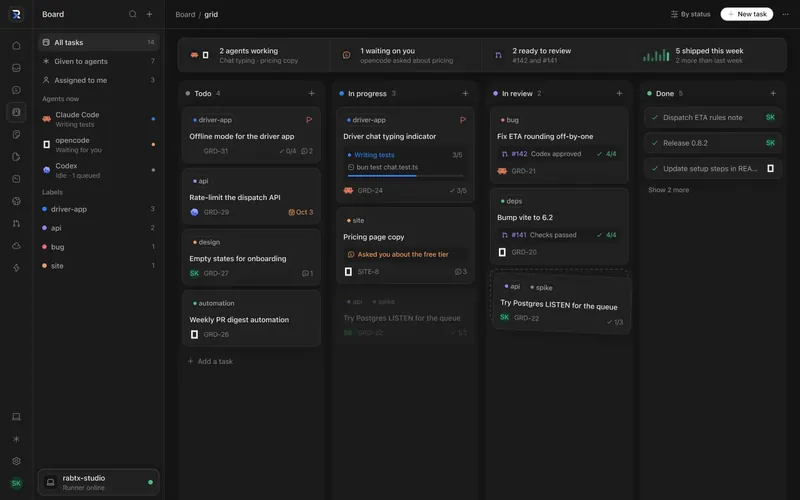
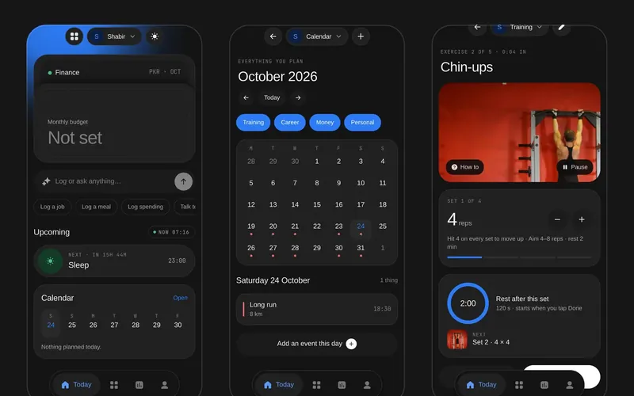
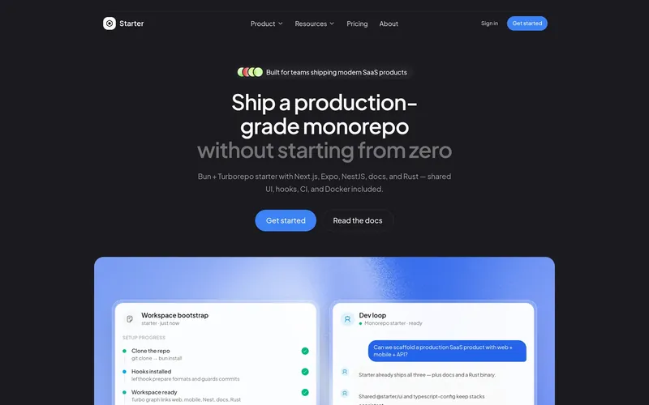
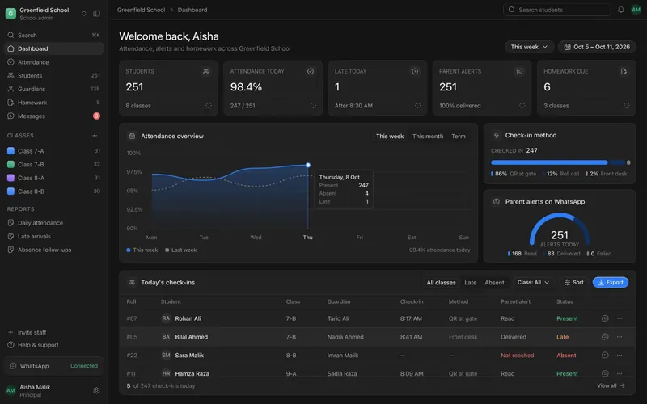
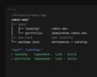
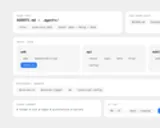
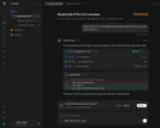
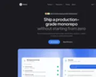
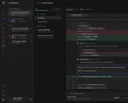

<!-- Mirrors shabirkhan.rabtx.dev. Content comes from apps/portfolio/src/data/profile.ts in rabtx-web. -->

<table>
  <tr>
    <td width="72" valign="middle"></td>
    <td valign="middle"><b>Shabir Khan</b> Senior Full-Stack Engineer</td>
  </tr>
</table>

Based in **Islamabad**, building web and mobile products end to end, from the interface and the API to the pipeline that ships them

Right now I am leading the frontend of **Auspira** at **Nexora AI**, and building [**Grid**](https://grid.rabtx.dev), an open-source workspace where people and AI coding agents work on the same project, now in public beta

The last eight years have moved between freelance work, an AI startup, and leading frontend teams, most recently on the rebuild of an HR platform used by PepsiCo and Intel

I share my work at [**shabirkhan.rabtx.dev**](https://shabirkhan.rabtx.dev), my [**CV**](https://shabirkhan.rabtx.dev/shabir-khan-cv.pdf) is a PDF, and I can be reached by [**email**](mailto:shabirkhan.dev@gmail.com)

 

### Highlights

<table>
  <tr>
    <td width="50%" valign="top">
      
       <b>Grid</b> &nbsp;<code>NEW</code> 
      Agent workspace · 2026
      
A self-hosted workspace where people and AI coding agents share one project board, live agent threads, a file editor, terminals and pull request checks, from desktop or phone. Works with Claude Code, Codex, opencode and any ACP agent

      <b>Role</b> Founder and lead engineer <b>Stack</b> SolidJS, Hono, PostgreSQL, Bun <b>Status</b> Public beta <b>License</b> MIT / Apache-2.0
      
<a href="https://grid.rabtx.dev">Live</a> · <a href="https://github.com/shabirkhan-dev/grid">GitHub</a>

    </td>
    <td width="50%" valign="top">
      
       <b>Synone</b> &nbsp;<code>NEW</code> 
      Life app · 2026
      
A mobile-first life app: plan the day, train, track money and meals, keep care routines and prayer times, and see all of it on one calendar. Offline first: everything is written on the phone and synced to your account in the background

      <b>Role</b> Author <b>Stack</b> Expo, Hono, Cloudflare Workers, PostgreSQL <b>Status</b> In development <b>License</b> MIT / Apache-2.0
      
<a href="https://github.com/shabirkhan-dev/personal-os">GitHub</a>

    </td>
  </tr>
  <tr>
    <td width="50%" valign="top">
      
       <b>Starter</b> 
      SaaS monorepo · 2025
      
A production-ready SaaS monorepo on Bun and Turborepo: Next.js, Expo, NestJS and Fumadocs apps sharing one UI layer, one TypeScript config and one CI pipeline

      <b>Role</b> Author <b>Stack</b> Next.js, Expo, NestJS, Bun, Turborepo <b>License</b> MIT / Apache-2.0
      
<a href="https://starter-two-henna.vercel.app">Live</a> · <a href="https://github.com/shabirkhan-dev/starter">GitHub</a>

    </td>
    <td width="50%" valign="top">
      
       <b>School OS</b> 
      School platform · 2025
      
A multi-tenant school platform: a teacher scans a student's QR code at the gate, the parent gets a WhatsApp alert, and the principal's dashboard updates. Students, guardians, staff, attendance, homework and assessments are built; parent alerts are next

      <b>Role</b> Author <b>Stack</b> Next.js, Expo, NestJS, PostgreSQL <b>Status</b> In development
      
<a href="https://github.com/shabirkhan-dev/school-os">GitHub</a>

    </td>
  </tr>
</table>

### Projects

| | |
| --- | --- |
| [**Grid**](https://grid.rabtx.dev) `NEW` | A workspace where people and AI coding agents share one board, threads, terminals and pull requests · [GitHub](https://github.com/shabirkhan-dev/grid) |
| [**Synone**](https://github.com/shabirkhan-dev/personal-os) `NEW` | Your day, training, money, food and faith on one calendar, offline first on your phone · [GitHub](https://github.com/shabirkhan-dev/personal-os) |
| [**Starter**](https://starter-two-henna.vercel.app) | A production monorepo with Next.js, Expo, NestJS and docs, ready on the first day · [GitHub](https://github.com/shabirkhan-dev/starter) |
| [**School OS**](https://github.com/shabirkhan-dev/school-os) | School operations for many schools at once, with QR attendance and alerts to parents · [GitHub](https://github.com/shabirkhan-dev/school-os) |

### Writing

<table>
  <tr>
    <td width="96"></td>
    <td><a href="https://rabtx.dev/writing/synone-a-life-app-that-works-offline"><b>Synone: a life app that works offline first</b></a> Synone puts your day, training, money, food and faith on one calendar. The hard part was not the screens. It was making every one of them work without a network.</td>
  </tr>
  <tr>
    <td width="96"></td>
    <td><a href="https://rabtx.dev/writing/two-sites-one-bun-workspace"><b>Two sites, one Bun workspace</b></a> The RabtX site and my portfolio were two repos that kept growing the same components. Moving them into one Bun workspace took an evening, and most of the lessons came from the upgrades, not the merge.</td>
  </tr>
  <tr>
    <td width="96"></td>
    <td><a href="https://rabtx.dev/writing/architecture-for-the-agent-era"><b>Architecting a project for the agent era</b></a> When coding agents write most of the code, the way you structure a project matters more than ever. Here is how I set up RabtX Starter and Grid, piece by piece, and why each piece is there.</td>
  </tr>
  <tr>
    <td width="96"></td>
    <td><a href="https://rabtx.dev/writing/ui-ux-design-in-the-ai-era"><b>UI/UX design in the AI era: tips, tricks and a cheat sheet</b></a> An AI model can draw a screen in ten seconds now. That is the problem. When anyone can generate a dashboard, the dashboard stops being the work.</td>
  </tr>
  <tr>
    <td width="96"></td>
    <td><a href="https://rabtx.dev/writing/building-grid-with-the-agents-it-runs"><b>Building Grid with the agents it runs</b></a> Grid is a workspace for people and coding agents. I built most of it the same way it asks you to work: agents on a board, each in its own lane, with me reviewing every change.</td>
  </tr>
  <tr>
    <td width="96"></td>
    <td><a href="https://rabtx.dev/writing/frontend-performance-under-real-traffic"><b>Frontend performance under real traffic</b></a> Lab scores are useful. Real users on mid-range phones and hotel Wi‑Fi are the exam.</td>
  </tr>
  <tr>
    <td width="96"></td>
    <td><a href="https://rabtx.dev/writing/building-multi-tenant-admin-systems"><b>Building multi-tenant admin systems</b></a> Multi-tenant is not a database flag. It is a product architecture that either protects customers or slowly mixes them together</td>
  </tr>
  <tr>
    <td width="96"></td>
    <td><a href="https://rabtx.dev/writing/make-shipping-boring-on-purpose"><b>Make shipping boring on purpose</b></a> The best release process is the one nobody has to heroically remember.</td>
  </tr>
</table>

### Work

| | |
| --- | --- |
| `2026 – Now` 🟢 | **Nexora AI** · Senior Frontend Lead, contract Leading the frontend of Auspira, a contract-management platform for a UK client |
| `2025 – Now` 🟢 | **RabtX** · Founder Building Grid, Synone, School OS and Starter, each designed and shipped end to end |
| `2024 – 2026` | **Kansai Group** · Frontend Engineer, Web and Mobile, part-time Built the Expo app, the vehicle listing site and the admin panel for a used-car exporter in Osaka |
| `2023 – 2025` | **Excelorithm** · Lead Frontend Engineer Led the rebuild of BullseyeEngagement, an HR platform used by PepsiCo, Intel and Emory, with 35% faster page loads |
| `2021 – 2023` | **Revoxai** · Senior Full-Stack Developer Built an AI e-learning platform: the Next.js frontend and the Node.js APIs behind it |
| `2018 – 2021` | **Freelance** · Software Developer Web and mobile apps for clients, on Fiverr and direct |

### Skills

| | |
| --- | --- |
| **Frontend** | React 19, Next.js, SolidJS, React Native and Expo, TanStack Query, Zustand, Tailwind CSS, design systems |
| **Backend & data** | Node.js, NestJS, Hono, Bun, Express, PostgreSQL, Redis, SQLite, Drizzle, Prisma |
| **Delivery** | Docker, GitHub Actions, Azure Pipelines, AWS, Vitest, Biome, Lefthook |
| **AI** | LLM APIs, coding-agent integration (ACP, Claude Code, Codex), RAG, local models |

---

### Elsewhere

Open to remote, hybrid and relocation, full-time or contract

[Portfolio](https://shabirkhan.rabtx.dev) · [LinkedIn](https://linkedin.com/in/shabirkhan23) · [Email](mailto:shabirkhan.dev@gmail.com) · [CV (PDF)](https://shabirkhan.rabtx.dev/shabir-khan-cv.pdf)

© 2026 Shabir Khan · Islamabad, Pakistan
